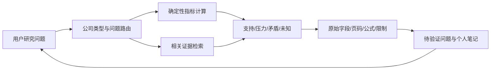

# 产品说明｜把未知变成研究行动

## 用户、任务与选择

目标用户是具备基本财务常识、但缺乏证据组织能力的个人研究者。典型任务不是“告诉我买不买”，而是“为什么利润和现金流不同向，哪个解释更有依据”。用户要在10分钟内发现核心分歧、读到原始披露，并留下可继续验证的问题。

选择贵州茅台，因为品牌消费企业需要联合观察盈利、渠道结构与回款；其财务公司又使合并现金流不等于酒业务现金流。这个特殊性能够检验产品是否真正理解公司类型，避免套用统一比率就输出标签。重点不是指标越多越好，而是解释的边界能否被用户看见。

## 最小闭环

7个维度全部有可操作入口。经营质量和财务趋势聚焦利润、毛利率与现金流；估值是有明确假设的计算工具；行情在没有可靠数据时显示缺口，并提供本地序列计算；行业位置采用同年度同行观察和渠道结构；事件风险提供披露时间线及相互竞争的解释。

## 信息结构

双轴表达：认识状态为事实、推断、待验证；证据方向为支持、压力、矛盾、未知。方向指向具体研究命题，不代表整只股票好坏。管理层说过某句话可以被证实，其陈述内容是否真实仍可能未知。现金流+120.07%是确定性重算，终端需求改善则不能从这一数字单独推出。

不做综合评分：分数容易隐藏数据缺失和证据冲突。总览以一个有来源的分歧句开场，随后是3个关键指标和4种证据卡。点击任何证据进入右侧抽屉：来源 → 原始字段/公式 → 适用限制 → 后续验证。抽屉提供交叉阅读，减少停留在单一来源的风险。

## AI Native 的产品取舍

AI的价值是组织研究问题、连接证据与揭示解释的适用条件。代码负责数值和口径，模型不应承担除法或补全缺失数据。当前无凭据时使用可复现的核验解读；配置模型后只选择和排序证据ID，将生成边界收紧在已验证的知识内。此版本牺牲开放问答的丰富度，换取每条输出都能审计。后续可以在用户明确需求下增加抽取器和逐句引用校验，而不是直接放开自由生成。

## 异常与状态

| 情况 | 用户可见行为 |
|---|---|
| 模型未配置 | 显示未配置与已核验解读 |
| 失败、超时、无效ID | 显示降级，继续使用带版本的快照 |
| 行情未连接 | 不显示价格、走势、分位 |
| 年度成本未收录 | 毛利率显示未收录 |
| 年度与前三季度 | 各自同期比较，不拼接增速 |
| 用户要目标价或买卖 | 不生成交易结论，给可研究的问题 |
| 其他标的 | 明确不支持，不套用主公司数据 |
| CSV错误 | 显示错误，不保留上一次计算为本次结果 |

## 可验证的成功指标

后续用户测试应测量：首次问题到原始披露的完成率、识别事实与推断的正确率、看到矛盾后是否修正假设、能否说出尚缺的数据、能否留下可执行问题。不要将停留时长或给出投资结论的速度作为唯一成功标准。本次没有招募真实用户，未伪造可用性量化结果。

## 继续迭代

优先接入带授权和时间戳的行情/财务服务，建立字段血缘、披露更正、缺失与冲突状态；增加独立动销和渠道库存；扩大同行样本并控制可比性。随后完善日期过滤、来源链接失效检测、模型调用频控、会话取消和数据获取审计。当前公开演示未配置付费模型，生产化前需配置身份与配额。
